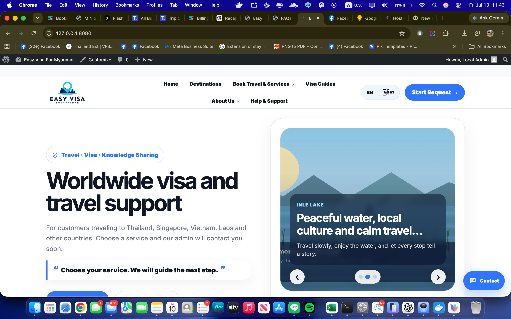

# Easy Visa For Myanmar WordPress Theme

WordPress theme for visa and travel support services worldwide. Main coverage: Thailand, Singapore, Vietnam, Laos, Malaysia, and other countries.

**Current version:** `v59 / 1.5.9`
**WordPress:** 6.0+
**PHP:** 7.4+
**Theme folder:** `easy-visa-myanmar/`

Developer: Min SiThu — https://minsithu.org — https://github.com/itsmeminsithu/

## Preview

The package includes a real homepage screenshot as the WordPress theme preview and the repository preview image. There is no live GitHub preview for a WordPress theme; the site itself runs on WordPress.

Theme URL: https://easyvisaformyanmar.com/



## Layout

The editable theme source is in `easy-visa-myanmar/`. The installable WordPress ZIP is in `releases/`.

## What it does

- Homepage with hero, random quote, and call-to-action.
- **Book Travel & Services** request section with 6 service tabs.
- Mobile service dropdown for phone use.
- Full service pages for Letter Service and TM30 Service.
- Visa Guides / Blog with categories, archive, single guide pages, search, updated-date labels, and Start Request CTAs.
- Inquiries saved in WordPress Admin, with workflow statuses and private admin notes.
- FAQ CMS with service groups.
- Destinations CMS.
- Customer Reviews CMS, shown in public only when real live reviews exist.
- Hero Slides CMS and Popup Messages CMS.
- Basic SEO meta, schema output, sitemap reference, and search engine verification fields.
- Spam, scam, bot, and login protections, plus WordPress hardening.

## Services

**Flight Ticket** — fields: name, contact info, preferred contact method, from, to, departure, return, passengers, privacy consent.

**Hotel Rent** — fields: name, contact info, preferred contact method, destination, check-in, check-out, guests, rooms, privacy consent.

**Easy Pass Services** — airports `DMK`, `BKK`, `CNX`. Visa types: TR Visa, ED Visa, DTV Visa, Visa on Arrival, Business Visa, Non-B, Non-O, Non-Immigrant, Transit, Other Visa.

**Easy Extension** — Arrival Visa and TR Visa, with `e Extension` and `Walk In VIP Extension` methods.

**Letter Service** — Myanmar nationality only. Options:

- Visa Extension (ဗီဇာသက်တမ်းတိုး)
- Bank Recommendation Letter (ဘဏ်ဖွင့်ဖို့ ထောက်ခံစာ)
- Driving License Recommendation Letter (ယာဉ်မောင်းလိုင်စင်ပြုလုပ်ဖို့ - တိုးဖို့ ထောက်ခံစာ)
- Motorcycle / Car Buying Letter (ယာဉ်ဝယ်ဖို့ ထောက်ခံစာ)

**TM30 Service** — no passport upload on the website. Fields: name, country, contact info, region, delivery method, notes, privacy consent. Regions: Bangkok, Chiang Mai, Mae Sot. Delivery: LINE, Facebook, Email, Message, Telegram, WhatsApp.

## Install

1. Download `easy-visa-myanmar-wordpress-theme-v59.zip`.
2. In WordPress Admin, go to **Appearance -> Themes -> Add New -> Upload Theme**.
3. Upload the ZIP and activate the theme.
4. Go to **Appearance -> Easy Visa Setup -> Create / Refresh Starter Pages**.
5. Go to **Settings -> Permalinks -> Save Changes**.
6. Set **Appearance -> Customize -> Easy Visa Home Settings**.
7. Create and assign the Primary Menu.
8. Add real FAQs, reviews, guide posts, destinations, and photos.

## Production setup

- HTTPS only.
- Cloudflare or hosting WAF/DDoS protection.
- SMTP plugin or server SMTP.
- Strong admin password and two-factor authentication.
- Backups kept off the server, on a regular schedule.
- Keep WordPress, plugins, and theme updated.
- SEO plugin is optional: Yoast SEO, Rank Math, AIOSEO, or SEOPress.
- Translation plugin is optional: Polylang or TranslatePress.

## Security notes

The theme has nonce checks, honeypots, timed form tokens, rate limits, suspicious content checks, link limits, temporary blocking, login throttling, XML-RPC disabled, REST user listing restricted, author enumeration blocked, comments/pingbacks disabled, generator tag removed, pingback header removed, and security headers.

A theme cannot stop a network-level DDoS on its own. Use Cloudflare or your hosting provider for that.

## Repository structure

```text
├── easy-visa-myanmar/              # WordPress theme folder
├── docs/                           # recaps, guides, screenshots, mindmap
├── releases/                       # installable theme ZIP (v59)
├── README.md
├── CHANGELOG.md
├── SECURITY.md
└── .gitignore
```

## Changelog summary

- **v50 / 1.5.0** — Letter Service and TM30 Service booking tabs, pages, FAQ groups, validation options.
- **v51 / 1.5.1** — Removed TM30 passport upload, back to a basic-request-only flow.
- **v52 / 1.5.2** — Full landing pages for Letter Service and TM30 Service.
- **v53 / 1.5.3** — Homepage section renamed to Book Travel & Services; Visa Guides / Blog added.
- **v54 / 1.5.4** — Stricter form validation, inquiry status workflow, admin notes, safer starter-page setup, service-specific Thank You messages.
- **v55 / 1.5.5** — Removed the "Not sure?" detail blocks from homepage forms.
- **v56 / 1.5.6** — Removed fake reviews; better mobile service selection, form errors, inquiry filters, copy buttons, guide search, updated-date labels.
- **v57 / 1.5.7** — Spam/scam protection, login hardening, WordPress hardening, security headers, SECURITY.md.
- **v58 / 1.5.8** — Developer metadata across theme, docs, and handoff files.
- **v59 / 1.5.9** — Supplied homepage screenshot set as the theme preview (`screenshot.png`); PDF/project/GitHub/mindmap handoff files refreshed; delivery packages synced.

## License

GPLv2 or later.
